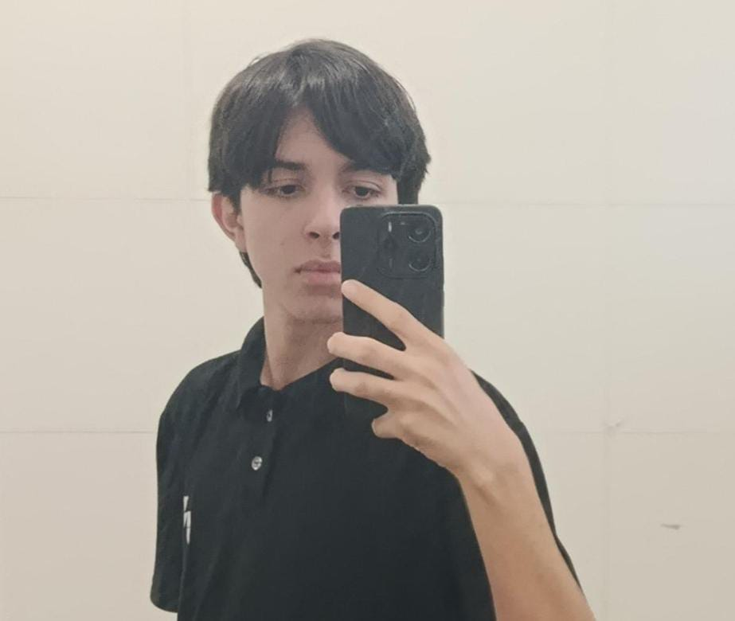
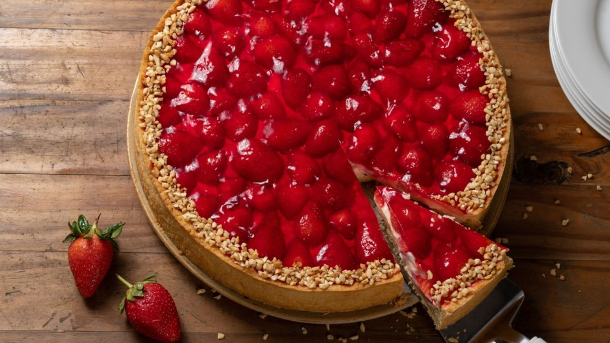
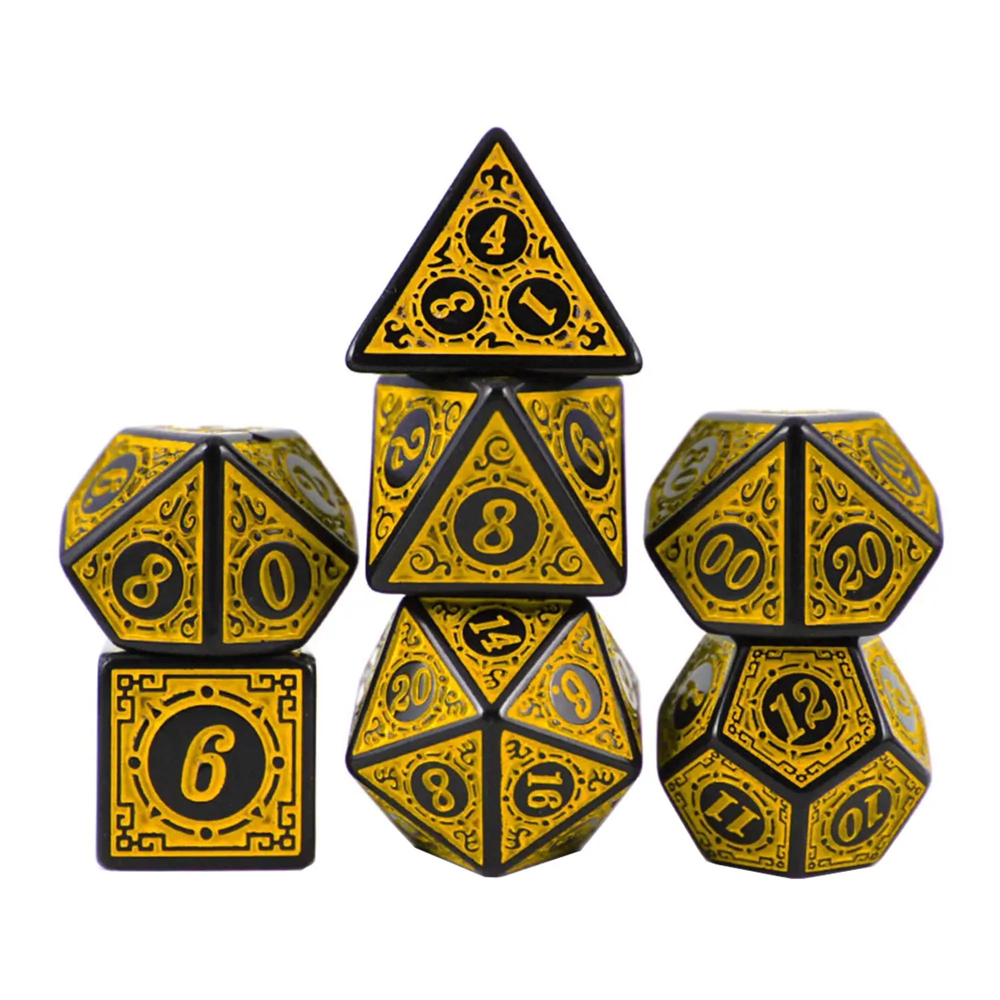
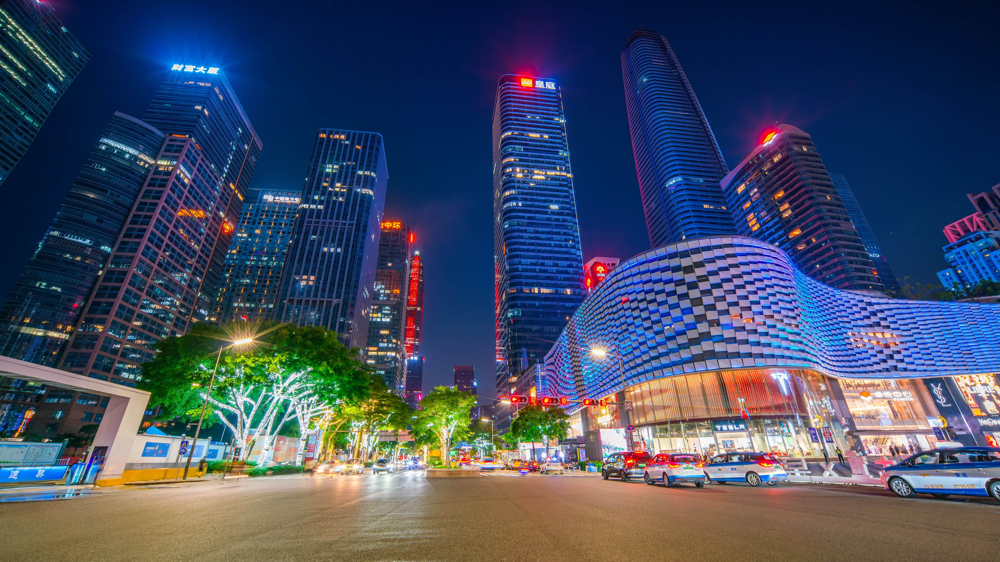
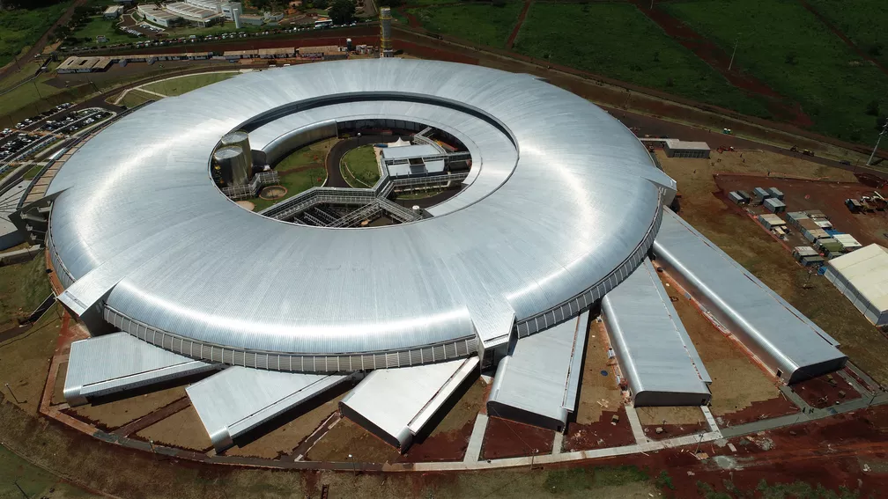

<!DOCTYPE html>
<html lang="pt-br">
<head>
    <meta charset="UTF-8">
    <meta name="viewport" content="width=device-width, initial-scale=1.0">
    <title>Apresentação Pessoal</title>

    <link rel="stylesheet" href="https://cdnjs.cloudflare.com/ajax/libs/font-awesome/6.5.2/css/all.min.css">

    
</head>
<body>

    <nav class="menu">
        <a class="ativo" href="#apresentacao">Apresentação</a>
        <a href="#curiosidades">Curiosidades</a>
        <a href="#lugares">Lugares</a>
    </nav>

    <main class="conteudo">

        <header class="perfil" id="apresentacao">
            

            

                <h1>Heitor Lira Rangel</h1>

                

                    <i class="fa-solid fa-graduation-cap"></i>
                    1º ano D Ensino Tech
                

                

            

        </header>

        <section class="secao" id="curiosidades">

            

                

                    <i class="fa-regular fa-lightbulb icone-titulo"></i>
                    <h2>Curiosidades</h2>
                

                

            

            <article class="item">
                <i class="fa-solid fa-kitchen-set icone"></i>

                

                    <h3>Eu amo cozinhar.</h3>
                    
Cozinhei tortas, bolos e salgadinhos, só nesse mês.

                

                
            </article>

            <article class="item">
                <i class="fa-solid fa-utensils icone"></i>

                

                    <h3>Minha comida preferida é macarrão.</h3>
                

                
            </article>

            <article class="item">
                <i class="fa-solid fa-gamepad icone"></i>

                

                    <h3>Meu hobbie preferido é jogar/montar RPGs.</h3>
                

                
            </article>

        </section>

        <section class="secao" id="lugares">

            

                

                    <i class="fa-solid fa-location-dot icone-titulo"></i>
                    <h2>Lugares que já fui</h2>
                

                

            

            <article class="item">
                <i class="fa-solid fa-water icone"></i>

                

                    <h3>Circuito das Águas São Lourenço (MG)</h3>
                    

                        É um complexo de águas minerais, com fontes
                        de água quente e fria, piscinas, parques e
                        muita natureza. Um lugar ótimo para relaxar
                        e aproveitar o dia.
                    

                

                
            </article>

            <article class="item">
                <i class="fa-solid fa-ticket icone"></i>

                

                    <h3>Beto Carrero World</h3>
                    

                        Um dos maiores parques temáticos da América
                        Latina, com montanhas-russas, shows, áreas
                        temáticas e muita diversão para todas as idades.
                    

                

                
            </article>

            <article class="item">
                <i class="fa-solid fa-ticket-simple icone"></i>

                

                    <h3>Hopi Hari</h3>
                    

                        Parque de diversões em Vinhedo (SP),
                        com atrações radicais, temáticas e
                        para todas as idades.
                    

                

                
            </article>

        </section>

        <section class="secao" id="destinos">

            

                

                    <i class="fa-solid fa-plane icone-titulo"></i>
                    <h2>Lugares que quero ir</h2>
                

                

            

            <article class="item">
                <i class="fa-solid fa-landmark icone"></i>

                

                    <h3>China (Shenzhen)</h3>
                    

                        Um dos maiores polos de tecnologia do mundo,
                        referência em inovação, eletrônicos e
                        desenvolvimento de IA. Quero conhecer a cultura,
                        a tecnologia e o estilo de vida local.
                    

                

                
            </article>

            <article class="item">
                <i class="fa-solid fa-earth-americas icone"></i>

                

                    <h3>Espaço</h3>
                    

                        Quero ver de perto o que sempre me fascinou:
                        o universo. Visitar centros espaciais,
                        museus e, quem sabe, um dia, ver a Terra
                        do espaço.
                    

                

                
            </article>

            <article class="item">
                <i class="fa-solid fa-atom icone"></i>

                

                    <h3>CNPEM – Campinas</h3>
                    

                        Centro de pesquisa de referência no Brasil,
                        com laboratórios de ponta em materiais,
                        biotecnologia, energia e nanotecnologia.
                    

                

                
            </article>

        </section>

    </main>

</body>
</html>
